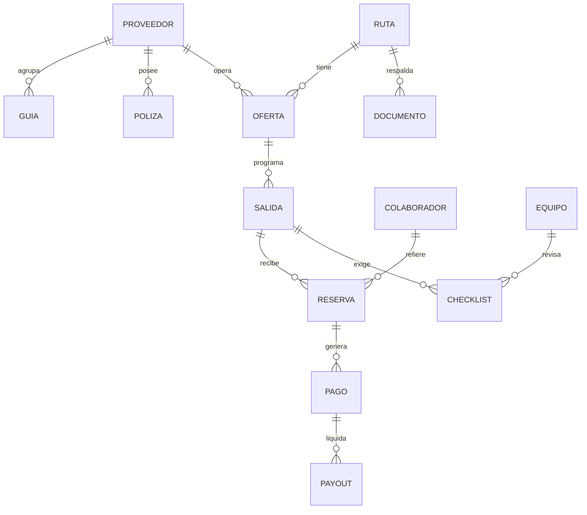
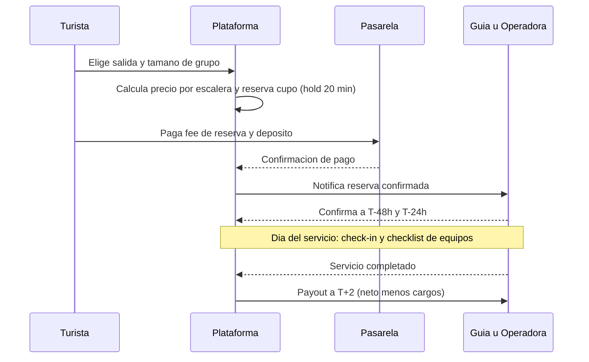

# N06 · Arquitectura de plataforma

> Especificación funcional/técnica **neutral de tecnología** para que otras herramientas (p. ej. Claude en PowerShell) la contrasten con el código existente del sitio web. Las reglas citan las notas fuente.

## 1. Módulos
| Módulo | Responsabilidad | Ideas |
|---|---|---|
| Catálogo y búsqueda | Búsqueda con mapa, filtros, fichas SEO ES/EN | [[I14 Plataforma estilo Airbnb solo tours con mapa y buses\|I14]] |
| Rutas y dossiers | Asistente de creación, GPX, plantillas por modalidad, PDF versionado | [[I15 Modo turista y modo guia asistente de creacion de rutas\|I15]], [[I18 Automatizacion documental legal por ruta\|I18]], [[I22 Biblioteca de rutas precreadas y onboarding\|I22]] |
| Proveedores y habilitación | Verificación de catastro, clasificaciones, pólizas, vigencias, strikes | [[I06 Reclutamiento de guias desde el Catastro Turistico\|I06]], [[I29 Seguros y requisitos de las plataformas globales\|I29]], [[I30 Marco legal de los guias ambitos y plan de habilitacion\|I30]] |
| Salidas y disponibilidad | Salidas compartidas, cupos, mínimos, cutoff, asignación | [[I03 Red de operadoras revendedoras y consolidacion de grupos\|I03]], [[I17 Flujo de reserva con confirmacion de disponibilidad\|I17]], [[I20 Asignacion automatica de guia cupos y desbordamiento\|I20]] |
| Reservas y checkout | Estados, holds, política de cancelación, links | [[I17 Flujo de reserva con confirmacion de disponibilidad\|I17]], [[I28 Enlaces de pago y de ruta compartibles marketing viral\|I28]] |
| Pagos y ledger | Cobro, retención, payouts T+2, cargos, conciliación | [[I07 Pagos retencion de fondos split y fondo de respaldo\|I07]], [[I08 Reserva no reembolsable\|I08]] |
| Mensajería | Chat enmascarado + WhatsApp, línea de coordinación | [[I16 Bot intermediario cliente guia y prevencion de fuga de datos\|I16]] |
| Colaboradores | QR, atribución, comisiones/fees | [[I24 QR en hoteles atribucion de origen y comision\|I24]] |
| Reputación y ranking | Reseñas verificadas, score, bonus de creador | [[I23 Ranking y visibilidad de guias operadoras y colaboradores\|I23]], [[I21 Rutas sin dueno ficha unica y multiples proveedores\|I21]] |
| Operación de campo | Check-in, checklist de equipos, incidentes | [[I13 Incumplimiento del guia no activa el tour o no se presenta\|I13]], [[I19 Almacenamiento documental nube fisica NAS y registro de equipos\|I19]] |
| Backoffice | Aprobaciones, disputas, reportes, alertas de vigencia | [[I02 Solo un medio traslado de responsabilidad al guia\|I02]] |
| Contenido digital (F3) | 360/3D, pases de ruta, audioguías | [[I26 Rutas digitales 3D datos de ruta de pago y explicaciones de pago\|I26]] |
| Agente de ventas (F3) | Asistente con herramientas | [[I35 Agente de ventas con IA\|I35]] |

## 2. Modelo de entidades


## 3. Flujo de reserva y pago


## 4. Esquema de ruta (JSON de referencia)
```json
{
  "id": "R-0001",
  "titulo": "Cascada ejemplo",
  "modalidad": "senderismo",
  "canton": "Mendez",
  "creador_id": "P-0007",
  "trazado": {"tipo": "LineString", "formato": "GeoJSON", "gpx_url": "..."},
  "dificultad": "media",
  "duracion_horas": 4,
  "edad_minima": 8,
  "capacidad": {"tope_general": 16, "por_modalidad": 8, "limite_sitio": null},
  "riesgos": ["resbalones", "crecida"],
  "puntos_evacuacion": [{"lat": 0, "lng": 0, "descripcion": "..."}],
  "equipo_requerido": ["botas", "casco"],
  "documentos": {"plan_operacion_contingencia": "doc-id", "plan_mantenimiento": "doc-id", "consentimiento_informado": "plantilla-v1"},
  "estado": "borrador",
  "sensible": false
}
```

## 5. Máquinas de estado
- **Ruta:** `borrador → en_revision → publicada | observada → suspendida`.
- **Salida:** `abierta → confirmada → garantizada → en_curso → completada | cancelada | reprogramada`.
- **Reserva:** `cotizada → solicitada → aceptada → pagada → confirmada → en_curso → completada` · ramas: `cancelada_cliente | cancelada_proveedor | no_show | reembolsada | disputa` ([[I17 Flujo de reserva con confirmacion de disponibilidad|I17]]).
- **Proveedor:** `en_revision → activo → suspendido → baja` (strikes y vigencias).

## 6. Reglas críticas (resumen ejecutable)
```text
R1  precio_publico(salida) = f(n_confirmados)  # sin dependencia del canal              (I03, I09)
R2  capacidad = min(16, limite_sitio, ratio_modalidad * n_guias)                         (I20, H04)
R3  elegible(guia, ruta) = clasificacion_cubre(modalidad, canton) AND registro_vigente
                           AND NOT suspendido AND certificado_ruta                       (I30)
R4  aventura (excepto senderismo) => proveedor.tipo IN {operador, agencia_dual}          (H02)
R5  payout = servicio.fecha + 2d  SI completado ; neto - cargos                          (I07)
R6  falla_proveedor => refund 100% + cargo_proveedor + strike                            (I02, I13)
R7  venta.bloqueada SI poliza.vencida O documento.vencido                                (I29, I18)
R8  chat: bloquear telefono/email/url ; liberar proxy el dia del servicio                (I16)
R9  vendedor_registro = agencia (Nanturia) ; guia NUNCA vende ni cobra por su cuenta     (H03)
R10 pie de pagina con registro, LUAF, direccion, telefono, politicas, datos              (H08)
```

## 7. Requisitos no funcionales
- **Seguridad:** roles y permisos (turista, guía, operadora, colaborador, admin), registro de auditoría, protección contra OWASP Top 10, secretos fuera del repositorio.
- **Privacidad (LOPDP):** minimización, cifrado en tránsito y reposo, retención definida, derechos ARCO/ARSO, consentimiento de contacto ([[N09 Verificaciones pendientes#V10 LOPDP bases de licitud, registro y uso del catastro para contactar guías|V10]]).
- **Disponibilidad:** respaldo 3-2-1 de base y archivos ([[I19 Almacenamiento documental nube fisica NAS y registro de equipos|I19]]); objetivo de recuperación documentado.
- **Rendimiento móvil**, accesibilidad (WCAG AA), i18n ES/EN, SEO.
- **Observabilidad:** logs de pagos, colas de notificaciones, métricas de embudo.

## 8. Integraciones previstas
Pasarela de pagos con split/payout ([[N04 Decisiones abiertas#D05 Proveedor de pagos y custodia de fondos|D05]]) · WhatsApp Business API ([[N09 Verificaciones pendientes#V13 Condiciones de WhatsApp Business API|V13]]) · mapas (OpenStreetMap/Mapbox) · correo transaccional · almacenamiento de documentos ([[I19 Almacenamiento documental nube fisica NAS y registro de equipos|I19]]) · facturación electrónica SRI ([[N09 Verificaciones pendientes#V09 Tratamiento tributario|V09]]) · analítica.

## 9. Opciones de arranque tecnológico (para decidir con base en el sitio existente)
- **F0:** páginas simples + formulario + link de pago + hoja de cálculo (sin desarrollo a medida).
- **F1:** aplicación web con base relacional con soporte geoespacial; panel de guía; ledger sencillo.
- Elegir stack según el código ya existente y las habilidades del equipo; evitar reescrituras innecesarias.
